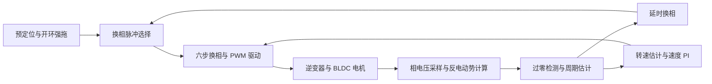

# BLDC 无感六步换相仿真

基于 MATLAB/Simulink 与 Simscape Electrical 搭建的无刷直流电机（BLDC）无位置传感器六步换相仿真模型。

主模型为 `six_stepItext.slx`，将开环启动、PWM 同步电压采样、悬空相反电动势计算、过零检测、延时换相、转速估计和速度 PI 调节组织在同一套仿真系统中，用于学习与研究无感六步控制的启动过程、换相时序和闭环运行机制。

## 控制流程

启动阶段通过预定位与开环强拖建立初始运行状态。运行过程中采集三相端电压，计算虚拟中性点电压，并根据当前换相步选取悬空相反电动势。过零检测结合检测窗口、预武装条件和预期边沿生成有效过零事件，经延时逻辑形成闭环换相脉冲。

转速估计结果反馈至速度 PI 控制器，用于调节 PWM 占空比。逆变器与 BLDC 电机采用物理建模模块，便于将控制器内部状态与电机响应对照观察。



上图概括主要信号流，具体使能、复位、限幅和故障处理连接以模型为准。

## 模块组成

| 模块 | 主要作用 |
| --- | --- |
| `Startup_OpenLoop_Control` | 生成开环转速轨迹、扇区周期与启动换相脉冲 |
| `BEMF_Sampling` | 进行 PWM 同步采样、虚拟中性点计算、悬空相选择与滤波 |
| `ZC_Window_Generator` | 根据扇区计时和参考周期生成过零检测窗口 |
| `ZC Closed&Detect` | 组织过零检测、周期匹配、闭环切换、延时换相及超时判断 |
| `SixStep_CommutationLogic` | 根据换相脉冲更新步号，查表生成三相六步控制状态 |
| `Duty_PWM_Manager` | 管理启动占空比、闭环占空比与 PWM 采样触发信号 |
| `Speed_PI_Controller` | 根据参考转速和估算转速计算占空比调节量，包含积分限幅与抗饱和反馈 |
| `Inverter_BLDC_Plant` | 仿真直流电源、三相逆变器、BLDC 电机及电压、电流和机械量测量 |
| `Observe` | 集中观察参考转速、估算转速、电机转速、换相脉冲和闭环模式状态 |

模型还保留了 `Hall_Commutation_Reference` 参考支路。无感控制的运行步骤使用 `SixStep_CommutationLogic` 输出的换相信号。

## 运行环境

- MATLAB 与 Simulink，模型保存版本为 **R2024a**。
- Simscape。
- Simscape Electrical。

## 默认仿真配置

以下数值取自当前 `six_stepItext.slx` 的保存配置。

| 项目 | 保存值 |
| --- | --- |
| 直流母线电压 | 12 V |
| 电机极对数 | 6 |
| PWM 周期与频率 | 50 μs，20 kHz |
| PWM 模块采样时间 | 1 μs |
| 换相逻辑及多处计时环节采样时间 | 10 μs |
| 速度 PI 积分环节采样时间 | 1 ms |
| 启动初始阶段时长与占空比 | 2 s，5% |
| 开环转速轨迹 | 初始 10 rpm，2 s 后按 20 rpm/s 上升，限幅至 100 rpm |
| 过零检测窗口 | 参考扇区周期的 25%～75% |
| 仿真起止时间 | 0～10 s |
| 求解器 | `ode23t` |
| 最大求解步长 | 1 μs |

控制逻辑采样时间、PWM 周期和求解器最大步长分别对应不同环节，调整时应结合采样触发与换相计时设置检查。

## 运行方法

1. 将仓库下载到本地，在 MATLAB 中切换到包含 `six_stepItext.slx` 的目录。
2. 执行以下命令打开主模型。

   ```matlab
   model = 'six_stepItext';
   open_system([model '.slx']);
   ```

3. 在模型顶层检查 `Manual Switch`，选择由 `SixStep_CommutationLogic` 经 `Mux2` 接入的无感换相支路。
4. 首次运行可使用 Normal 模式，保留模型保存的求解器和仿真时长设置。

   ```matlab
   set_param(model, 'SimulationMode', 'normal');
   simOut = sim(model);
   ```

5. 打开 `Observe` 查看运行信号。分析过零与换相时序时，可进一步进入采样和闭环检测子系统观察内部信号。

模型保存的仿真模式为 Accelerator，上述示例在内存中切换为 Normal 模式。

## 仿真观察内容

- **启动过程**，观察开环转速轨迹、换相步号和占空比的变化。
- **过零检测**，对照悬空相反电动势、检测窗口、预武装状态和有效过零事件。
- **换相时序**，对照过零事件、换相延时和步号更新，检查闭环切换前后的信号连续性。
- **速度控制**，对照参考转速、估算转速与电机模型输出转速，观察占空比调节过程。
- **异常处理**，检查启动超时、过零超时和故障锁存相关状态。

保存仿真结果时，可同时记录模型版本、负载工况、启动设置和检测参数，便于复现实验和比较不同版本。
